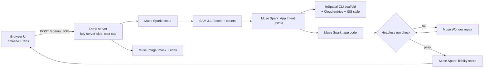

# Genesis Pro Builder

Turn a photo, a napkin sketch or a paper form into a running, data-backed app. Built on the Meta Model API by Genesis Pro (Beam XYZ Ltd) for the Meta Global AI Developer Hackathon 2026 (Startup track).

Upload an image and an agent pipeline runs in front of you on a live timeline:
1. **Scout** (Muse Spark) works out what the image is (sketch, shelf or form) and what objects to look for.
2. **SAM 3.1** segments those objects. Boxes are drawn over the input, and counts become seed data (for example, 6 jars of coffee become stock of 6).
3. **App Intent JSON** (Muse Spark, strict `json_schema` structured output) lists the entities, fields, screens, actions and seed records.
4. **InSpatial project**: `inspatial create` scaffolds the project, then the Cloud entries (`defineEntry`), API actions, seed data and ISS `createStyle` are generated from the intent.
5. **App code** (Muse Spark) produces a single-file preview app backed by localStorage.
6. **Build + run check**: headless Chromium loads the app, catches errors and clicks the actions. On failure, **Muse Wonder** repairs the code (up to 3 attempts).
7. **Fidelity score** (Muse Spark) compares the input image with a screenshot of the running app.
8. Optional **hi-fi mock** (Muse Image), with multi-turn edits via `previous_response_id`.

## Models used
| Model | Used for |
|---|---|
| `muse-spark-1.3` | scout, App Intent (structured output), code generation, fidelity scoring |
| `sam-3.1` | object segmentation and counting (boxes; masks not decoded) |
| `muse-wonder-1.0` | repair escalation when the build/run check fails |
| `muse-image-1.0` | hi-fi mock and multi-turn edit; sample input images |

## Architecture


## Setup and run
Requirements: Deno 2, Python 3 with Playwright (`pip install playwright && playwright install chromium`), and optionally the InSpatial CLI.
```bash
cp .env.example .env   # set MODEL_API_KEY (never commit it)
deno run -A server.ts  # http://localhost:8787
```
Optional env vars: `COST_CAP_USD` (global hard cap, default 15) and `RUN_CAP_USD` (per run, default 1.00). Spend is tracked in `data/ledger.json`. `-contributor` models are refused in code.

Eval: `python3 tools/run_eval.py samples/ <label> [fault]`, then open the Eval tab.

## Sample inputs
`samples/` contains juniper-cafe-sketch, pantry-shelf, signup-form, bakery-case and grooming-booking-sketch (all generated with Muse Image).

## Measured results (10 runs: 5 images × 2, 3 Nov 2026)
- 10/10 reached a running app on the first pass with 0 repairs.
- Median time 64.1 s (min 48.6 s, max 75.0 s).
- Median cost $0.044 per app; the 10 runs cost $0.45 in total.
- Median fidelity score 88.5/100 (scored by Muse Spark).
- Fault-injected run: Muse Wonder repaired it in one attempt (67.6 s, $0.107).

## Limitations
- The generated client is an InSpatial Kit + ISS screen: a hero built from the input photo, item cards with SAM 3.1 box crops of that photo (a monogram tile when SAM found no box), stock bars with low-stock badges, and working +/- and Place order/Top up actions that read and write InSpatial Cloud entries (Place order creates an `order` entry and restocks the item to par). Verified locally with `inspatial dev` against the local cloud. Known limits: the dev-studio "InCloud" realtime badge reads disconnected, the client seeds Cloud from the extracted data on first load (server seed is not applied), and InSpatial ID sign-in is not configured. The live hosted preview is still the Spark-generated single-file HTML app.
- InSpatial (Kit, Cloud, CLI) is proprietary to its owners and is not included in or covered by this repository's licence; packages are fetched at runtime.
- SAM 3.1 masks aren't decoded; only boxes are drawn. Some objects are missed, and Spark corrects counts of 0.

## License
MIT © 2026 Beam XYZ Ltd (Genesis Pro)
